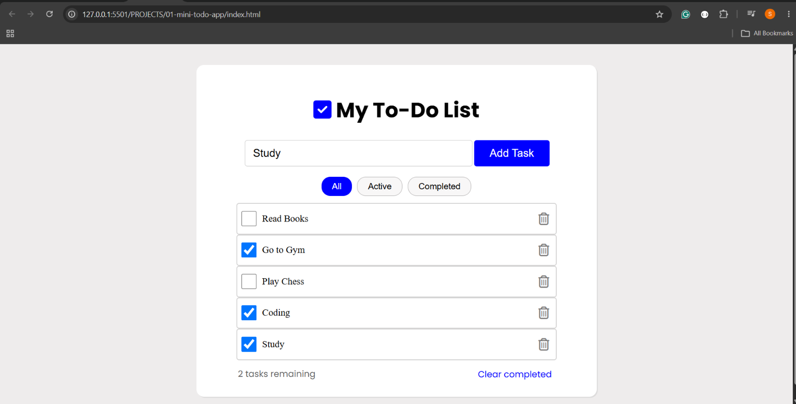
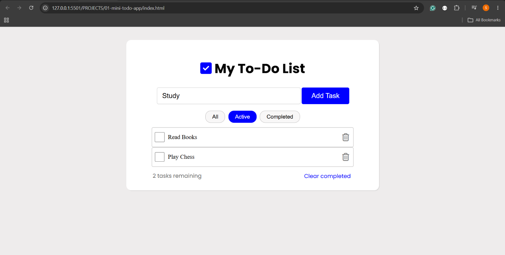
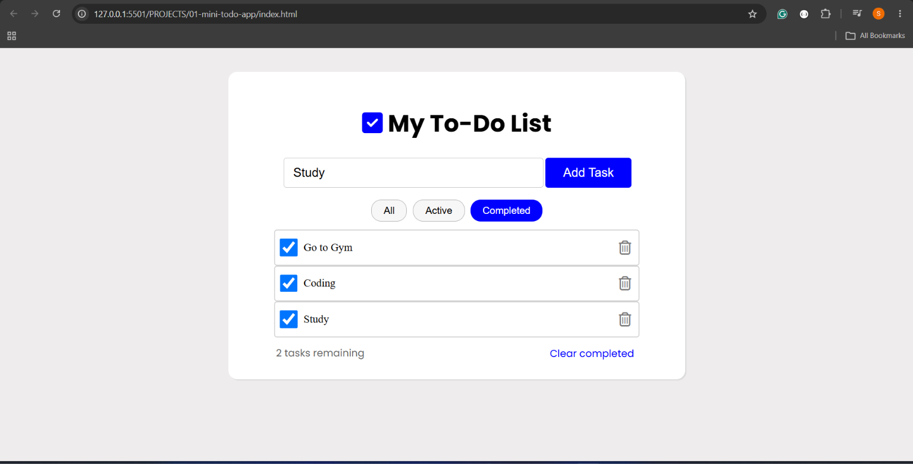

# Mini To-Do App

A simple and interactive To-Do List application built using HTML, CSS and vanilla JavaScript. 
This project was created to practise JavaScript fundamentals and DOM manipulation by building a functional application from scratch.

## Features

- Add new tasks.
- Prevent duplicate tasks.
- Mark tasks as completed or active.
- Filter tasks by All, Active and Completed.
- Delete individual tasks.
- Clear all completed tasks.
- Display the number of remaining tasks.
- Dynamically update the task list without reloading the page.

## Technologies Used

- HTML5
- CSS3
- JavaScript (Vanilla JavaScript)
- DOM Manipulation
- VS Code

## Screenshots

### All Tasks


### Active Tasks


### Completed Tasks


## How to Run Locally

1. Clone this repository:

   ```bash
   git clone https://github.com/shamitmoolya/mini-todo-app.git
   ```

2. Open the project folder.
3. Open `index.html` in your browser.

No additional dependencies or installations are required.

## What I Learned

- Selecting and manipulating DOM elements.
- Handling user events with event listeners.
- Working with arrays and objects.
- Using array methods such as `filter()`, `findIndex()` and `some()`.
- Dynamically creating and removing HTML elements.
- Managing application state using JavaScript.

## Future Improvements

- Save tasks using localStorage so they persist after refreshing.
- Add the ability to edit existing tasks.
- Improve accessibility and keyboard interaction.
- Add responsive design improvements for different screen sizes.